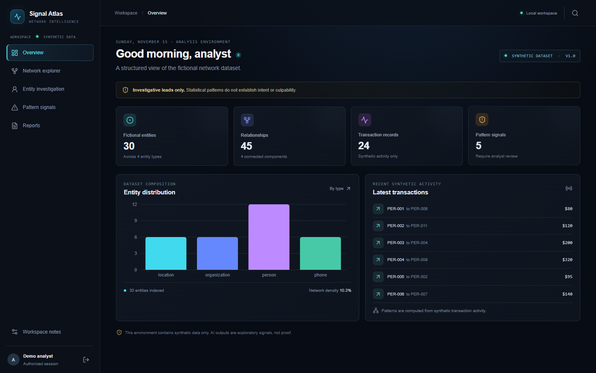
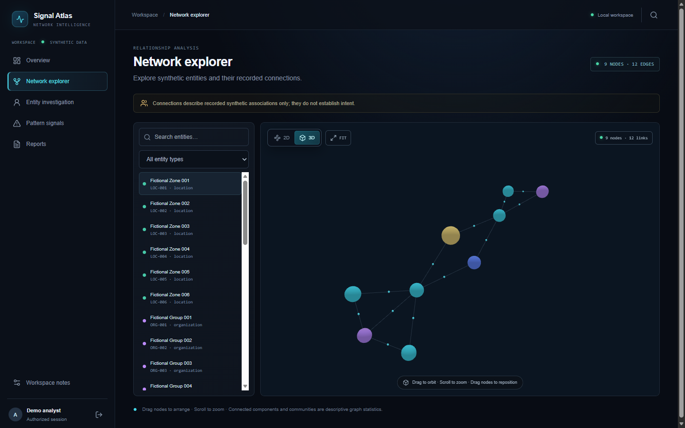
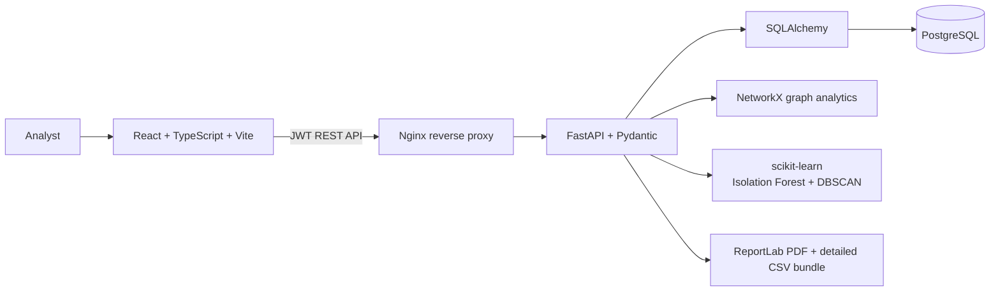

# Signal Atlas

### AI-Powered Criminal Network Analysis System · SIH26189

A polished, analyst-oriented demo for investigating **fictional, synthetic network data**. This application does not connect to real criminal databases, does not identify real people as criminals, and does not use sensitive personal attributes for scoring. Statistical output is exploratory context—not proof, an accusation, or a person-level risk assessment.

## Screenshots

> Captured from the running local application. All displayed records are synthetic.

| Intelligence dashboard | Interactive 3D network explorer |
|---|---|
|  |  |

## Architecture



### Project structure

```text
frontend/
  src/components/        Login, navigation shell
  src/pages/             Dashboard, 2D/3D graph, entity, signal, report views
  src/services/          Authenticated API client and download helpers
backend/
  app/api/               Authenticated REST endpoints
  app/models.py          SQLAlchemy relational schema
  app/services/          Graph analytics, ML, PDF and CSV generation
  app/synthetic.py       Reproducible, labeled synthetic test-data generator
  migrations/            Alembic schema migrations
  tests/                 API, exports, analytics and scale checks
docker-compose.yml       PostgreSQL, API and Nginx-hosted frontend
```

## Features

- **Intelligence dashboard:** synthetic entity/relationship totals, component and density metrics, transaction activity, and signal counts.
- **Network explorer:** searchable and type-filtered entity list; draggable, zoomable 2D view or interactive WebGL 3D force graph; hover details, orbit, pan, and fit-to-view.
- **Entity workspace:** fictional profile, associated records, and chronological transaction, contact, relationship, and location timeline.
- **Pattern analysis:** exploratory transaction outliers and descriptive shared-location, dense-community, and repeated-pair patterns.
- **Network statistics:** degree, betweenness, and closeness centrality; PageRank; connected components; density; communities; shortest path.
- **Investigation reports:** readable multi-page PDF with full finding explanations, limitations, and a network diagram; detailed CSV ZIP with summary, findings, entity, and relationship tables.
- **Security and persistence:** JWT authentication, Argon2 password hashes, analyst-role checks, public auth rate limits, API audit records, PostgreSQL, and Alembic migrations.

## Run using Docker

1. Copy `.env.example` to `.env`.
2. Set `JWT_SECRET_KEY` to a long, unique random value and replace the local database/demo credentials.
3. From the project root, run:

   ```powershell
   docker compose up --build
   ```

4. Open <http://localhost:8080>. OpenAPI documentation is available at <http://localhost:8000/docs>.
5. Local demo sign-in: `analyst@fictional.test` / `demo-pass-01` (replace before any non-local use).

Docker starts PostgreSQL, applies the initial Alembic migration, seeds fictional records, and serves the web app through Nginx. PostgreSQL data persists in the `postgres_data` volume.

## Local development

Backend, from `backend/`:

```powershell
python -m venv .venv
.\.venv\Scripts\Activate.ps1
pip install -r requirements.txt
$env:DATABASE_URL = "sqlite:///./network_analysis.db"
$env:JWT_SECRET_KEY = "local-only-change-me"
alembic upgrade head
uvicorn app.main:app --reload
```

Frontend, from `frontend/`:

```powershell
npm install
npm run dev
```

Vite forwards `/api` requests to `http://localhost:8000`.

## Anomaly model and scale evaluation

The current unsupervised transaction pipeline:

1. Builds two non-sensitive transaction features: log-transformed amount and the combined transaction count of both endpoints.
2. Fits a deterministic Isolation Forest (`random_state=42`) with a configurable contamination setting (default 5%).
3. Uses DBSCAN on robust-scaled transaction amounts (`eps=0.75`, `min_samples=5`) to identify amount-density noise.
4. Reports the union of both signals, per-model signal flags, an in-sample relative outlier score, and an explanation.

An outlier score is **not a probability or confidence that a person did anything**. The sample is synthetic, intentionally small, and not representative of actual activity. Contamination is a model setting, not a measured real-world event rate.

The backend tests generate 1,200 reproducible synthetic transactions (100 fictional entities, 60 planted amount outliers) and compare findings with test-only ground-truth references. The regression checks require **at least 0.80 precision and 0.95 recall** on that fixed sample. A measured local run flagged 72 transactions, achieving **0.833 precision** and **1.000 recall** in 0.246 seconds for analysis. These are synthetic pipeline checks—not production model validation or a guarantee on other data. Run with:

```powershell
cd backend
python -m pytest -q
```

## API reference

Except for register, login, and health, endpoints require `Authorization: Bearer <token>`.

| Method | Route | Description |
|---|---|---|
| POST | `/api/auth/register`, `/api/auth/login` | Register or obtain a JWT |
| GET | `/api/dashboard/overview`, `/api/dashboard/statistics` | Synthetic dashboard metrics |
| GET | `/api/entities`, `/api/entities/search`, `/api/entities/{id}` | List, search, and inspect entities |
| GET | `/api/entities/{id}/activity` | Entity profile and timeline |
| GET | `/api/relationships`, `/api/relationships/graph/{id}` | Relationships and ego graph |
| POST | `/api/analysis/network` | Network summary and communities |
| GET | `/api/analysis/centrality`, `/api/analysis/communities` | Graph metrics and community membership |
| GET | `/api/analysis/patterns` | Descriptive repeated and dense patterns |
| GET | `/api/analysis/shortest-path?source_id=...&target_id=...` | Shortest path between fictional entities |
| POST / GET | `/api/ml/anomaly-detection`, `/api/ml/results` | Run or retrieve anomaly findings |
| POST / GET | `/api/reports/generate`, `/api/reports` | Generate or list reports |
| GET | `/api/reports/{id}/download?format=csv\|pdf` | PDF report or ZIP of detailed CSVs |

PDFs include a finding-by-finding explanation/limitations table and a network visualization. The `.csv.zip` export contains:

- `summary.csv` — reference, scope, graph statistics, model configuration, and disclaimer.
- `anomaly_findings.csv` — transaction/endpoints, amount/currency, score, model flags, explanation, and limitations.
- `entities.csv` — entity IDs, labels, and types in graph scope.
- `relationships.csv` — edge endpoints, relationship type, and weight.

## Validation

```powershell
cd backend
python -m pytest -q
cd ..\frontend
npm test
npm run build
npm audit
cd ..
docker compose config -q
```

## Privacy and operational limitations

- Every seeded profile, organization, number, zone, interaction, and transaction is fictional. Reserved `555-01xx` identifiers are used.
- No real criminal, telecom, financial, or identity database is accessed.
- Centrality and community membership describe graph topology only; they do not establish intent or culpability.
- Outlier results are investigative leads for review, not evidence, verdicts, or automated classifications.
- The demo has no production identity provider, account recovery, key rotation, enterprise audit retention, or deployment hardening. Do not expose it publicly with demo credentials or development secrets.
