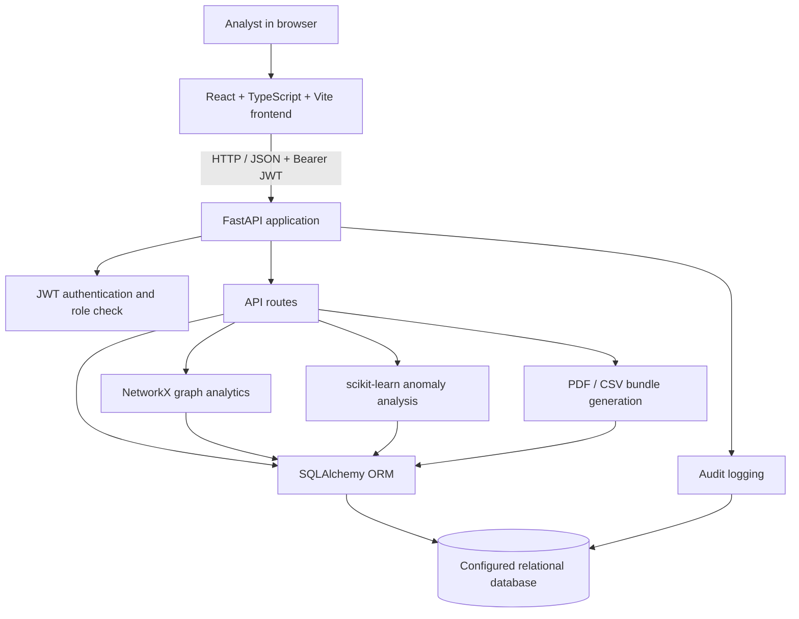
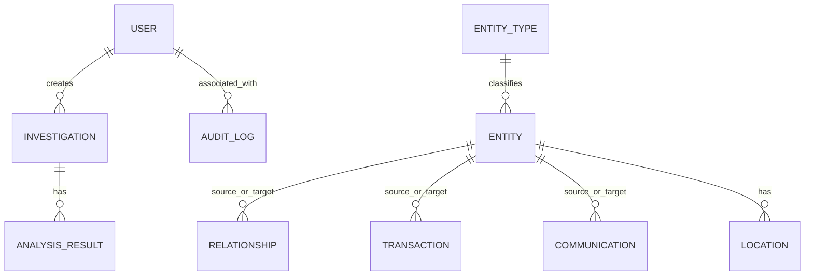
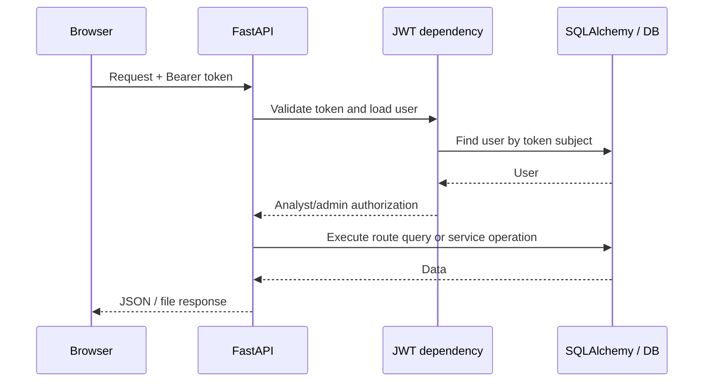
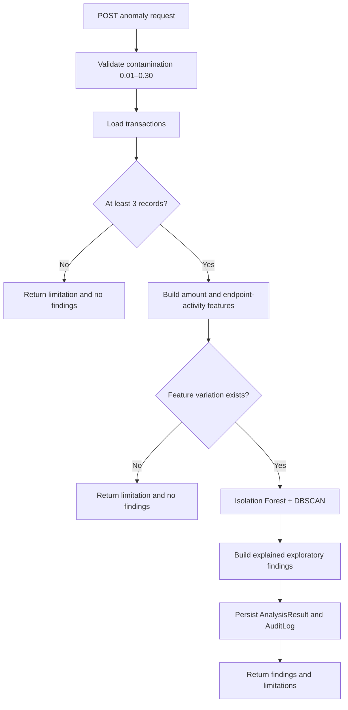

# High-Level Design (HLD)
## Signal Atlas — AI-Powered Synthetic Criminal Network Analysis

| Field | Value |
|---|---|
| Product | Signal Atlas |
| Challenge reference | SIH26189 |
| Document version | 1.0 |
| Status | Implemented prototype |
| Last updated | 15 November 2026 |

## 1. Purpose

This document describes the high-level architecture of Signal Atlas based on the inspected repository implementation. The system provides a React web interface, a FastAPI service, SQLAlchemy persistence, graph analytics, exploratory anomaly detection, and report generation.

## 2. Architecture overview



The database engine is selected through `DATABASE_URL`. The backend configuration defaults to SQLite (`sqlite:///./network_analysis.db`). The repository's Docker Compose configuration starts PostgreSQL 16 and configures the backend to connect to it using `postgresql+psycopg`. Therefore, the database used depends on the runtime configuration.

## 3. Technology stack

| Layer | Technology | Responsibility |
|---|---|---|
| Web UI | React 18, TypeScript, Vite | User interface and client-side application |
| UI / visualization dependencies | React Flow, react-force-graph-3d, Recharts, Framer Motion, Lucide | Graph-oriented UI, charts, animation, icons |
| API | FastAPI, Uvicorn | HTTP endpoints and application lifecycle |
| Validation | Pydantic | Request/response data validation |
| Persistence | SQLAlchemy 2, Alembic | ORM and schema migrations |
| Database | SQLite by default; PostgreSQL in Docker Compose | Persistent relational data |
| Graph analytics | NetworkX | Graph construction, metrics, communities, shortest paths |
| Anomaly analysis | NumPy, scikit-learn | Isolation Forest, DBSCAN, robust scaling |
| Authentication | python-jose, pwdlib | JWT and password hashing |
| Rate limiting | SlowAPI | Registration/login rate limits |
| Reports | ReportLab and application reporting service | PDF and CSV bundle output |
| Containers | Docker, Docker Compose | Local multi-service deployment |

## 4. Major components

### 4.1 Frontend
The frontend is a React and TypeScript single-page application. The inspected source tree includes:
- `src/App.tsx` — application entry and authenticated/public application flow.
- `src/components/Login.tsx` — login UI.
- `src/components/Shell.tsx` — authenticated application shell/navigation.
- `src/pages/` — Dashboard, NetworkExplorer, Investigation, Anomalies, Reports, Settings, and LandingPage.
- `src/services/api.ts` — API client, bearer-token header, and report download helper.
- `src/types.ts` — shared TypeScript types.
- `public/` — static assets including robots.txt and sitemap.xml.

The API client reads `VITE_API_URL`, defaulting to `/api`, adds the stored access token as an Authorization bearer header, sets JSON content type for JSON bodies, and raises an error using the API detail when a response is not successful.

### 4.2 Backend API
`backend/app/main.py` creates the FastAPI application, seeds the database during lifespan startup, configures CORS, registers the API router, adds rate-limit exception handling, and installs request audit middleware.

`backend/app/api/routes.py` defines routes under `/api` and composes authentication, database access, analytics, and report services.

### 4.3 Security
- Passwords are hashed and verified using `pwdlib`'s recommended password hash.
- JWT access tokens include subject, role, and expiry claims.
- Protected routes use `require_analyst`, accepting roles `analyst` and `admin`.
- Registration and login are rate limited (5/minute and 10/minute respectively).
- API requests are audited by middleware except health, login, and registration paths; analysis and report actions also create explicit audit records.

### 4.4 Data access
`backend/app/database.py` creates the SQLAlchemy engine from settings and provides a session dependency. SQLite connections receive `check_same_thread=False`; connection pre-ping is enabled.

### 4.5 Graph analytics
`backend/app/services/analytics.py`:
1. Loads entities as graph nodes.
2. Loads relationships as graph edges.
3. Calculates connected components, density, node/edge counts.
4. Calculates degree, betweenness, closeness, and PageRank centrality.
5. Detects communities using greedy modularity communities.

### 4.6 Anomaly analysis
Transaction records are ordered by occurrence time. The implemented features are:
- `log1p(transaction amount)`
- combined transaction count of the source and target endpoints

Isolation Forest identifies statistical outliers. DBSCAN, applied to robust-scaled transaction amounts, identifies records outside dense amount clusters. Findings include signals, explanatory text, normalized relative score, and limitations. The score is not a calibrated probability.

### 4.7 Reporting
Report generation validates requested entity IDs, creates an investigation reference, constructs a report subgraph from selected entities and their direct neighbors (or the full graph when no entities are selected), adds network and anomaly information, persists the report payload, and writes audit records. Download endpoints provide PDF or ZIP containing CSV output.

## 5. Data architecture



The ORM models also include `AnalysisResult` records not necessarily associated with an investigation, such as standalone anomaly results. `Investigation.selected_entities` and `AnalysisResult.payload` use JSON columns.

## 6. Request flows

### 6.1 Authenticated API request



### 6.2 Anomaly analysis



## 7. Deployment architecture

The repository's `docker-compose.yml` defines:
- `db`: PostgreSQL 16 Alpine, persistent named volume, readiness health check.
- `backend`: built from `./backend`, exposed on host loopback port 8000, waits for healthy database, and has an API health check.
- `frontend`: built from `./frontend`, exposed on port 8080, waits for healthy backend.
- `postgres_data`: named persistent database volume.

The frontend production deployment and backend deployment are also configured separately in the hosted environment. Exact hosted environment values are external to the repository and must be maintained in the deployment provider.

## 8. Cross-cutting concerns

- **Validation:** Pydantic request models constrain credentials, report titles/entity lists, and anomaly contamination.
- **Error handling:** Routes use HTTP errors for invalid credentials, missing entities/reports, and unauthorized access.
- **Auditability:** Middleware and explicit route-level events persist selected activity.
- **Responsible interpretation:** Network metrics describe structure; anomaly outputs describe statistical differences in synthetic samples.
- **Configuration:** Environment-based settings control database connection and JWT configuration.

## 9. Known configuration considerations

1. `backend/app/config.py` defaults to SQLite and local-only JWT secret. Production deployments must override secrets and database URL.
2. Docker Compose uses PostgreSQL, but this does not prove that every hosted environment uses PostgreSQL.
3. `backend/app/main.py` currently lists `http://localhost:5173` as the allowed CORS origin. The deployed frontend origin should be explicitly verified/configured for cross-origin deployments.
4. The default demo credentials are local/demo configuration and must not be treated as production credentials.
5. Graph and anomaly operations load records into memory; performance at larger data volumes needs measurement.

## 10. Repository map

```text
backend/
  app/
    api/routes.py
    services/analytics.py
    services/reporting.py
    config.py
    database.py
    main.py
    models.py
    schemas.py
    security.py
    seed.py
    synthetic.py
  migrations/
  tests/
frontend/
  src/
    components/
    pages/
    services/api.ts
    App.tsx
    types.ts
docs/
docker-compose.yml
README.md
```
